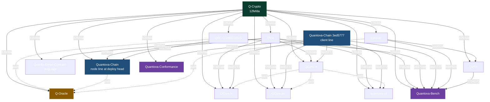

# Cross repo pin map

This map is read from the committed `Cargo.lock` and `Cargo.toml` of each repository in the stack, not from release notes. Every edge carries the commit the consumer beneath it resolves for the repository above it, as cargo recorded it in the lockfile, or the word path where the consumer builds a sibling checkout through a path dependency. Q-Crypto sits at the root because every repository signs and hashes through it. Two lines of the stack exist side by side. The node line is Quantova-Chain at its deploy head with QVM 4979bda and QRC-CONSENSUS a987564. The client line is Quantova-Chain 3ed5777 with QVM f7d82ab and QRC-CONSENSUS 96370ae, which is the set Quantova-Chain itself pinned at 3ed5777, and the SDKs, the CLI, the benchmark and the conformance runner build against it.

## The pins in use

Q-Crypto is resolved at 12fefda211c5b7f8a8e9ed60e6a35d880da54c38 by every lockfile in the map, and no lockfile carries a second Q-Crypto commit.

QVM is resolved at 4979bda62d1cf34a56ac7a523262eaa49d130140 by the node, and at f7d82abb13a01039d78dca732660fd6700d7b830 by the contract language, the three QCore packages, the CLI and the benchmark.

QRC-CONSENSUS is resolved at a987564d226037613a8d30022c343dab2dc07a34 by the node, and at 96370aeb7bb23e04ee177d3945659e5d53fdf09f by the benchmark, which is the commit Quantova-Chain 3ed5777 pins.

Quantova-Chain is resolved at 3ed57775e1171f870e0236d8d605e07b6dc03761 by the three QCore packages, the CLI, the benchmark and the conformance runner.

q-prover is resolved at bddf924e8e702bf72fd905b66558452c26520831 by QVRF, and the benchmark reaches it through QVRF 7734070198ca09892b90ca8eaf2221243bbe3949.

QCore.rs is a path dependency of QCore.js, QCore.py and quantova-cli. Path dependencies leave no commit in a lockfile, so each of those repositories declares the QCore.rs commit it is built against in its `cross-repo-pins` file, and its workflows check that commit out beside it.

Q-Oracle builds Q-Lightclient, QRC-CONSENSUS, Quantova-Chain and q-prover crates through path dependencies on sibling checkouts and carries no `cross-repo-pins` file, so those edges are not pinned by any lockfile.

## How the gate holds the map together

Every shared job builds with `--locked`, so no dependency resolves fresh. The pin agreement gate reads every git source in the lockfile and fails when a source names no rev or tag, when a rev is not a prefix of the commit it resolved to, or when one repository resolves to more than one commit. When a repository carries a `cross-repo-pins` file the gate also checks every declared commit or tag against the lockfile and requires every path dependency that leaves the repository to be declared. `docs/pin-agreement.md` describes the rules and the self test.
