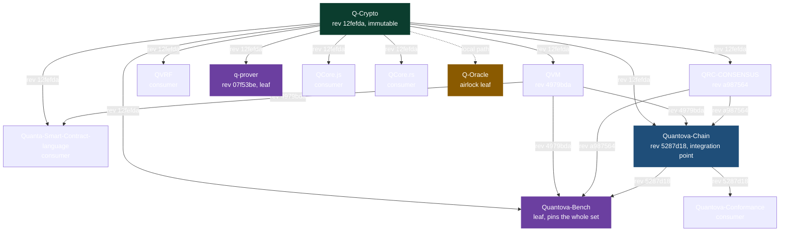

# Cross repo pin map

This is the complete cross repo pin map for the Quantova stack. It shows every repository that publishes a pin, the exact version each one publishes, and the direction every dependency points. Read it from the top. Q-Crypto sits at the root because it is the cryptography edge that everything signs and hashes against. The lines flow down through the virtual machine and the consensus layer, meet at Quantova-Chain which is the integration point, and end at Quantova-Bench which pins the whole set. Q-Oracle hangs off to the side as the airlock leaf that nothing else depends on.

Each line carries the exact version the consumer beneath it pins of the repository above it.

## What each pinned repository is and why others pin that exact version

Q-Crypto is the root of trust, the code that produces every signature and every hash in the stack. It is pinned by an immutable git commit, the revision 12fefda211c5b7f8a8e9ed60e6a35d880da54c38, and never by a tag. A tag is a friendly name that a maintainer can later move to point at different code, while a commit revision can never change once it exists. Because every other repository has to resolve the exact same cryptography, the one edge that is never allowed to drift is nailed to a commit that cannot be moved.

QVM is the secured virtual machine that runs contract code inside the chain. The node pins commit 4979bda. The contract language and the client SDKs pin commit f7d82ab, which carries the same instruction set and the same order signing context, so the bytecode the language emits and the bytecode the node executes are the same machine.

QRC-CONSENSUS is the QORUS committee consensus that decides which blocks become final. The node pins commit a987564 so that every validator agrees on the same voting and attestation rules, including the chain identifier that is folded into every attestation.

Quantova-Chain is the node and the ledger, the piece that brings the cryptography, the virtual machine, and the consensus together into one running program. It is the integration point, so the benchmark suite and the conformance runner both pin a commit of it and measure and test the real node rather than a loose collection of parts.

q-prover is the hash based STARK prover. It is a leaf, which means it pins the cryptography root but nothing in the core stack pins it back, so it can move forward on its own cadence without forcing the rest of the stack to rebuild.

Q-Oracle is the airlock, the component that reads and verifies foreign chains before their messages are allowed in. It is a leaf that nothing in the stack depends on, so nothing else has to resolve it, and it reaches the cryptography root through the same pinned commit as the rest of the stack.

## How the gate holds the map together

A consumer pins the exact commit of everything beneath it in the dependency stack, through git rev sources in its manifests and the committed lockfile, and every shared job builds with --locked so no dependency resolves fresh. The pin agreement gate in this repository checks tag sources. Commit pins are checked by the cross repo pins step in the QCore.rs, QCore.js, QCore.py and quantova-cli workflows, which fails when a locked Q-Crypto, Quantova-Chain or QVM revision differs from the pins file.
