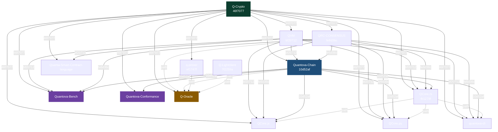

# Cross repo pin map

This map is read from the committed `Cargo.lock` and `Cargo.toml` of each repository in the stack, not from release notes. Every edge carries the commit the consumer beneath it resolves for the repository above it, as cargo recorded it in the lockfile, or the word path where the consumer builds a sibling checkout through a path dependency. Q-Crypto sits at the root because every repository signs and hashes through it. The stack runs on one line. The node, the SDKs, the CLI, the benchmark, the contract language and the conformance runner all resolve the same Q-Crypto, QVM, QRC-CONSENSUS and Quantova-Chain commits.

## The pins in use

Q-Crypto is resolved at 4e37c52984740f345f96e2c8536803bce5f3b805 by every lockfile in the map, and no lockfile carries a second Q-Crypto commit.

QVM is resolved at 94fe7e8a1758deca56910f2a5c634622345404ef by the node, the contract language, the three QCore packages, the CLI and the benchmark.

QRC-CONSENSUS is resolved at 8e998f97b5df74f8181c69ea980c0aaa1c120e2c by the node, the three QCore packages, the CLI and the benchmark.

Quantova-Chain is resolved at 14b1da3412e1af7eb41e4c58918eabca815dce18 by the three QCore packages, the CLI, the benchmark and the conformance runner.

QCore.rs is a path dependency of QCore.js, QCore.py and quantova-cli. Path dependencies leave no commit in a lockfile, so each of those repositories declares the QCore.rs commit 90cbf96c4575393197422ca63f0e0ea307a97605 in its `cross-repo-pins` file, and its workflows check that commit out beside it.

Q-Oracle builds Q-Lightclient, QRC-CONSENSUS, Quantova-Chain and q-prover crates through path dependencies on sibling checkouts. Its workflow checks out Q-Lightclient 7f2259a2e03594689a4132c7ecc07a85b347312d, QRC-CONSENSUS 8e998f97b5df74f8181c69ea980c0aaa1c120e2c, Quantova-Chain 14b1da3412e1af7eb41e4c58918eabca815dce18 and q-prover c56ce780ce3e20889fb3fab94c7dadc998809de3, together with QCore.rs 90cbf96c4575393197422ca63f0e0ea307a97605 and QVM 94fe7e8a1758deca56910f2a5c634622345404ef for the sibling crates those reach, so those edges are pinned by the workflow and not by a lockfile.

QVRF is not built by any repository in the map.

## How the gate holds the map together

Every shared job builds with `--locked`, so no dependency resolves fresh. The pin agreement gate reads every git source in the lockfile and fails when a source names no rev or tag, when a rev is not a prefix of the commit it resolved to, or when one repository resolves to more than one commit. When a repository carries a `cross-repo-pins` file the gate also checks every declared commit or tag against the lockfile and requires every path dependency that leaves the repository to be declared. `docs/pin-agreement.md` describes the rules and the self test.
